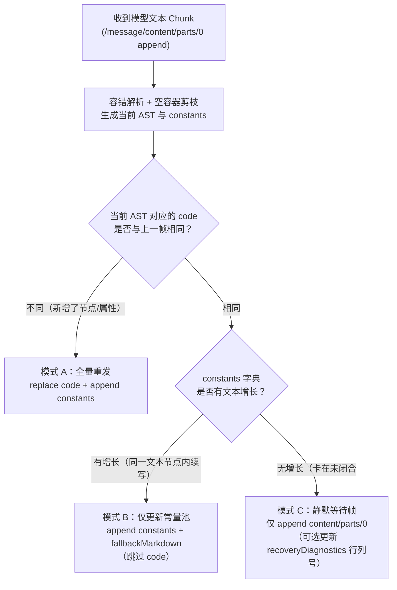
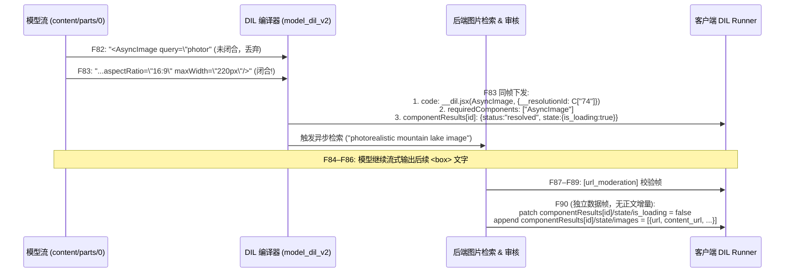

# ChatGPT DIL 流式生成与编译节奏实证研究

研究日期：2026-11-18（Asia/Shanghai）  
数据来源：[data/streams/6af6bbb9-0834-83ec-b670-72301e6eefa8/](../../data/streams/6af6bbb9-0834-83ec-b670-72301e6eefa8/)（`mitmdump` 逐 chunk 录制的完整 SSE 响应流，146 帧 / 849 KB）  
前置文档：[01-dil-empirical-research.md](./01-empirical-research.md)、[06-dil-compiler-and-runtime-architecture.md](./03-compiler-and-runtime.md)

---

## 1. 核心结论

通过对 [stream.sse](../../data/streams/6af6bbb9-0834-83ec-b670-72301e6eefa8/stream.sse) 与 [timeline.jsonl](../../data/streams/6af6bbb9-0834-83ec-b670-72301e6eefa8/timeline.jsonl) 的逐帧拆解，ChatGPT 服务端 DIL 编译器在流式阶段遵循以下 **5 条核心机制**：

1. **按 Chunk 同步驱动，而非固定定时器触发**：服务端在模型每吐出一个文本增量（`/message/content/parts/0` `append`）的**同一个 SSE `delta` 帧内**，同步下发对应的编译产物补丁（`code`、`constants`、`fallbackMarkdown`、`recoveryDiagnostics`）。
2. **`code` 全量替换（Replace）+ AST 差分去重**：编译后的 JavaScript 代码（`model_dil_v2/code`）从不做字符串级增量 diff，每次结构变化都以 `o: "replace"` 整体重发（本回合重发 88 次，放大倍数 44.1x）；但**当新增文本仅落在已有的文本/常量节点内、未改变 AST 拓扑结构时，编译器会跳过下发 `code`，仅追加 `constants` 字典**。
3. **未闭合起始标签静默丢弃（Unterminated Tag Drop）**：当流式游标停在标签名或属性中间（尚未遇到 `>` 或 `/>`，如 `<box background="rgba(34,197`）时，编译器丢弃该半截标签，该帧不产生新的 AST 节点。
4. **未闭合空容器剪枝（Empty Incomplete Container Pruning）**：即使外层容器标签已写完 `>`（如 `<grid columns={2}>\n <grid-item>`），只要它仍处于流式未闭合状态且内部**尚未产出任何有效可渲染的子节点**，编译器会将其整枝剪除，直到第一个非空子节点（如文字或图标）到达时才连同外层容器一次性挂入 `code`，从而彻底避免屏幕上闪现高度为 0 的空边框。
5. **异步宿主组件（`AsyncImage`）双轨并发回填**：模型一旦闭合 `<AsyncImage .../>` 标签，服务端在同帧立即注册 `componentResults[id]`（`is_loading: true`），并在后台并发执行图片搜索与 `url_moderation`，数帧后通过不含文本增量的独立 `delta` 帧将 `is_loading` 置为 `false` 并注入图片 URL。

---

## 2. 单回合流式全局统计

样本会话：`6af6bbb9-0834-83ec-b670-72301e6eefa8`（模型：`gpt-6-thinking`，`thinking_effort: extended`）。统计摘要见 [stats.json](../../data/streams/6af6bbb9-0834-83ec-b670-72301e6eefa8/stats.json)：

| 指标 | 实测数值 | 说明 |
|---|---:|---|
| SSE 原始字节数 | 849,128 B | 共 146 个有效 SSE 事件帧 + 3 个 `: ping` 心跳帧 |
| 正文增量帧数（含 `content/parts/0`） | 106 帧 | 从第 25 帧首个可见字符到第 142 帧正文结束 |
| 最终可见源码长度（`visible_text_len`） | 8,006 字符 | Markdown + 3 个顶层 `<box>` DIL 视图块 |
| 最终编译代码长度（`final_code_len`） | 13,328 字符 | 含 `__dilSafe` 与单棵 `DIL.render` 组件树 |
| **`model_dil_v2/code` 整体重发次数** | **88 次** | 占 106 个正文增量帧的 **83.0%** |
| `code` 累计传输字符数 | 588,143 字符 | 带宽放大倍数 **44.1x**（`588,143 / 13,328`） |
| 仅更新 `constants`（未重发 `code`）帧数 | 9 帧 | 文本在同一段落/粗体节点内增长，AST 结构未变 |
| 仅更新 `content/parts/0`（无编译产物）帧数 | 9 帧 | 游标正处于未写完的 `<tag attr=...` 或公式内部 |
| 最终常量池条目（`constants`） | 152 条 | 通过 `o: "append"` 增量追加或局部修正 |

---

## 3. 编译器的四种流式帧模式（逐帧证据）

以下帧号对应 [stream.sse](../../data/streams/6af6bbb9-0834-83ec-b670-72301e6eefa8/stream.sse) 中的块序号（与 [timeline.jsonl](../../data/streams/6af6bbb9-0834-83ec-b670-72301e6eefa8/timeline.jsonl) 对齐）。



### 3.1 模式 A：AST 结构变化 $\rightarrow$ 同帧全量 `replace` `code`（88 帧）

每当新增文本产生了新的段落、列表项、或闭合了一个新的 DIL 标签且内部已有可渲染内容时，服务端在同一帧内先更新 `constants`，紧接着全量替换 `code`。

以 **Frame 37 → Frame 38**（进入第一个 `<box>` 架构图）为例：

* **Frame 37 输入增量**：
  ```html
  <box border radius="lg" padding={3} gap={3}>
    <title size="lg">VAE Architecture</title>
    <box background="rgba(59,130,
  ```
* **Frame 37 编译器行为**：
  1. 识别到外层 `<box>` 和 `<title>`，将 `"VAE Architecture"` 写入 `constants["10"]`；
  2. 末尾的 `<box background="rgba(59,130,` 尚未闭合 `>`，直接丢弃，并压入诊断 `[{"code": "unterminated_tag", "action": "recovered_parse", "line": 18, "column": 3}]`；
  3. 自动补齐外层 `</box>`，下发 `code`（898 B）：
     ```javascript
     __dil.jsx("box", {"border":true,"radius":"lg","padding":3,"gap":3},
       __dil.jsx("title", {"size":"lg"}, __dilConstants["10"])
     )
     ```

---

### 3.2 模式 B：节点内文本续写 $\rightarrow$ 仅 `append` `constants`，跳过 `code`（9 帧）

当模型在一个已经挂载到 AST 的文本节点（如 `<text>` 或 `<bold>`）内部继续输出文字时，`code` 中的 `__dil.jsx("bold", null, __dilConstants["2"])` 引用关系没有任何变化。

以 **Frame 29 → Frame 32** 为例：

| 帧 | `content/parts/0` 新增文本 | `constants` 补丁 | `code` 补丁 |
|---|---|---|---|
| **Frame 29** | `"记住一个核心区别：\n\n**LLM Encoder 主要负责把输入转换"` | `{"1": "你可以先记住一个核心区别：", "2": "LLM Encoder 主要负责把输入转换"}` | **下发 `replace` (372 B)**（新增 `<bold>` 节点引用 `constants["2"]`） |
| **Frame 30** | `"成模型能够理解的特征表示；VAE Encoder 则负责把图像"` | `{"2": "LLM Encoder 主要负责把输入转换成模型能够理解的特征表示；VAE Encoder 则负责把图像"}` | **无（跳过）** |
| **Frame 31** | `"压缩成一个低维的、具有概率分布意义的"` | `{"2": "...压缩成一个低维的、具有概率分布意义的"}` | **无（跳过）** |
| **Frame 32** | `" Latent Representation，并且配套一个 Decoder，可以从"` | `{"2": "...Latent Representation，并且配套一个 Decoder，可以从"}` | **无（跳过）** |
| **Frame 33** | `" Latent 还原图像。**\n\n我们从架构开始看。\n\n## 1. VAE..."` | 更新 `"2"`，新增 `"3"`、`"4"`、`"5"` | **下发 `replace` (511 B)**（粗体结束，新增段落与 `<title>`） |

> **工程意义**：抽离 `constants` 常量池不仅是为了减小静态体积，更重要的是在流式输出长段落时**避免无意义的 VM 重编译**——客户端只需更新常量字典即可刷新文字。

---

### 3.3 模式 C：卡在未闭合标签属性或公式中 $\rightarrow$ 静默等待（9 帧）

当一个 chunk 全部处于未写完的起始标签属性内部，或处于多行数学公式 `\[ ... \]` 中间时，编译器不更新 `code` 也不更新 `constants`：

* **案例 1：长属性跨帧（Frame 51 → Frame 52 → Frame 53）**
  * **Frame 51 结尾**：停在 `\n    <box`（下发 `code` 2,619 B）。
  * **Frame 52 增量**：`" background=\"rgba(34,197,94,0.10)\" radius=\"md\" padding={2} align"`。此时依然未出现 `>`，**Frame 52 整帧只有一条 `/message/content/parts/0` append 操作**，`code`、`constants`、`fallbackMarkdown` 全部静默。
  * **Frame 53 增量**：`"=\"center\">\n      **Latent Vector z**\n    </box>..."` $\rightarrow$ 标签闭合且包含文字 `"Latent Vector z"`，立即恢复下发 `code`（2,784 B）。
* **案例 2：闭合标签恰好与自动恢复重合（Frame 41 → Frame 42）**
  * **Frame 41 结尾**：`<text size="xs" color="secondary">预测`（编译器自动补齐了 `</text></box>`，下发 `code` 1,579 B）。
  * **Frame 42 增量**：`" μ 和 σ²</text>\n    </box>\n    <icon name=\"arrow"`。其中 `" μ 和 σ²"` 更新了 `constants["15"]`；随后的 `</text></box>` 只是兑现了上一帧已经自动补齐的闭合标签；而末尾的 `<icon name="arrow` 尚未闭合被丢弃。因此 **Frame 42 的 AST 与 Frame 41 完全一致，只更新了 `constants["15"]`，未重发 `code`**。

---

### 3.4 模式 D：空容器剪枝（Frame 44 → Frame 45 → Frame 46）

这是流式 UI 防抖动最关键的实证发现。观察 **Frame 44 至 Frame 46** 的源码拼接过程：

* **Frame 44 结尾**：
  ```html
    **Latent Distribution**

    <grid columns
  ```
  此时 `code` 为 1,801 B（最后渲染的节点是 `<bold>Latent Distribution</bold>`，末尾未闭合的 `<grid columns` 被丢弃）。

* **Frame 45 增量**：
  ```html
  ={2} gap={2}>
        <grid-item>
          <box background="rgba(59,130,246
  ```
  注意：在 Frame 45 结束时，**`<grid columns={2} gap={2}>` 和 `<grid-item>` 的起始标签都已经完整闭合了 `>`**！
  然而，**Frame 45 依然没有下发 `code`（保持 1,801 B），只更新了 `recoveryDiagnostics` 的行列号（line 38, col 9）**。
  * **原因**：最内层的 `<box background="rgba(59,130,246` 还没写完，导致 `<grid-item>` 没有任何有效子节点，进而导致 `<grid>` 也没有任何有效子节点。编译器在 codegen 前**递归剪除了所有“尚未闭合且无有效后代”的空容器节点**。

* **Frame 46 增量**：
  ```html
  ,0.10)" padding={2} radius="md" align="center">
            **μ**

            <text size="xs" color
  ```
  一旦内层 `<box>` 闭合且产出了第一个可见子节点 `**μ**`（`constants["18"]`），**Frame 46 立即将 `grid` $\rightarrow$ `grid-item` $\rightarrow$ `box` $\rightarrow$ `text` $\rightarrow$ `bold("μ")` 整条路径一次性编译进 `code`（从 1,801 B 跳升至 2,035 B）**。

---

### 3.5 Markdown 语法的流式重解释（Frame 34 → Frame 35）

由于 ChatGPT 将普通 Markdown 也编译为 DIL 节点，当流式游标处于行首时，会发生**节点类型的动态修正**：

* **Frame 34**：刚输出 `"- **Encoder**：将输入数据"`（尚未换行或确认完整列表结构）。
  * 编译器先将其降级为普通 `<text>`：`__dil.jsx("text", null, __dilConstants["6"], __dil.jsx("bold", null, __dilConstants["7"]), __dilConstants["8"])`，其中 `constants["6"] = "- "`。
* **Frame 35**：继续输出 `"映射到 Latent Space 中的概率分布。\n- **Decoder**：从 Latent Space 中采样..."`。
  * 编译器识别出这是多项无序列表，立即在 Frame 35 将上一帧的 `<text>` **重写为 `<list marker="bullet"><list-item>...</list-item></list>`**，并把 `constants["6"]` 原地覆写为 `"Encoder"`（去掉了前面的 `"- "`）。

---

## 4. `recoveryDiagnostics` 的生命周期

在整个流式过程中，`model_dil_v2/recoveryDiagnostics` 精确反映了服务端容错解析器的状态机：

| 诊断代码 (`code`) | 触发场景 | 出现帧示例 | `action` |
|---|---|---|---|
| `unterminated_tag` | 游标停在 `<tag ...` 内部，尚未遇到 `>` | F37, F39, F42, F56, F81, F94, F124 | `recovered_parse` |
| `unclosed_block` | 顶层 `<box>` 或子容器已打开 `>`，但尚未遇到匹配的 `</box>` | F38, F40, F54, F57, F80, F93, F100, F126 | `recovered_parse` |
| `incomplete_source` | 块级数学公式 `\[` 已打开，但尚未遇到闭合的 `\]` | F61 (line 102), F71 (line 145) | `recovered_parse` |

**清零时机**：一旦顶层闭合标签到达（如 **Frame 58** 收到第一个 `</box>`、**Frame 62** 收到 `\]`、**Frame 73** 收到 `\]`、**Frame 101** 收到第二个 `</box>`、**Frame 137** 收到第三个 `</box>`），服务端在**同一帧**立即下发：
```json
{"p": "/message/metadata/model_dil_v2/recoveryDiagnostics", "o": "remove"}
```
因此，一个 DIL 视图块一旦闭合，`recoveryDiagnostics` 立即归零，直到正文中出现下一个未闭合的公式或 `<box>`。

---

## 5. 异步宿主组件（`<AsyncImage>`）的流式时间线

本回合包含两个 `<AsyncImage>` 调用，清晰展示了**编译树下发**与**异步数据回填**的解耦：



1. **占位先行（Frame 83 & Frame 100）**：`<AsyncImage .../>` 自闭合标签刚写完的同一帧，编译器生成 UUID（如 `a588d0a9-b3f2-5d84-b96a-e7dbc7573701`），写入 `constants["74"]`，并在 `appData.opGenui.componentResults` 中初始化 `is_loading: true` 和 `frame_aspect_ratio: "16:9"`。客户端立即按 16:9 比例渲染图片骨架屏（不会引起后续 Layout Shift）。
2. **后台检索与安全审核（Frame 87–89 & Frame 103–105）**：模型继续往下写文字的同时，服务端并行下发 `url_moderation` 帧。
3. **异步回填（Frame 90 & Frame 106）**：检索完成后，下发专门的数据补丁帧将 `is_loading` 改为 `false` 并填入 `images` 数组，客户端 `<AsyncImage>` 组件响应式替换为真实图片。

---

## 6. 对自研 DIL 渲染器（`pi-web-ui`）的设计准则

基于上述实测行为，我们在客户端实现“Markdown Block + DIL Block 分离渲染”时，只需吸收以下 **3 条极简准则** 即可复刻同等级别的流式体验：

1. **块级切分隔离**：
   * 正文中的普通 Markdown（含代码块、LaTeX 公式 `\[...\]`、GFM 表格）保留给 `Streamdown`，避免像 ChatGPT 那样为了单行 `- **Encoder**` 跨帧重改 AST 节点类型。
   * 仅将顶层 `{@body}` 与 `<box>` / `<row>` / `<grid>` / `<list>` / `<svg>` 切分为独立的 `DILBlock`。
2. **流式解析三原则**：
   * **丢弃末尾未闭合的 `<tag ...`**：扫描到文件末尾时，若最后一个 `<` 尚未配对 `>`，直接截断丢弃（对应 ChatGPT 的 `unterminated_tag` 规则）。
   * **自动补齐未闭合容器栈**：对已闭合 `>` 但尚未遇到 `</tag>` 或 `{/if}`、`{/each}` 的节点，在末尾虚拟闭合（对应 `unclosed_block` 规则）。
   * **递归剪除未闭合的空容器**：若一个容器节点满足 `!node.closed && renderedChildren.length === 0`，在本次渲染中返回 `null`（对应 Frame 45 的**空容器剪枝**规则），杜绝空框闪烁。
3. **AST 结构或可见文本变化时才触发重绘**：
   * 当新增流式字符全部落在未闭合的起始标签属性内（如 Frame 52）时，直接跳过重渲染，保持上一帧视图稳定。
