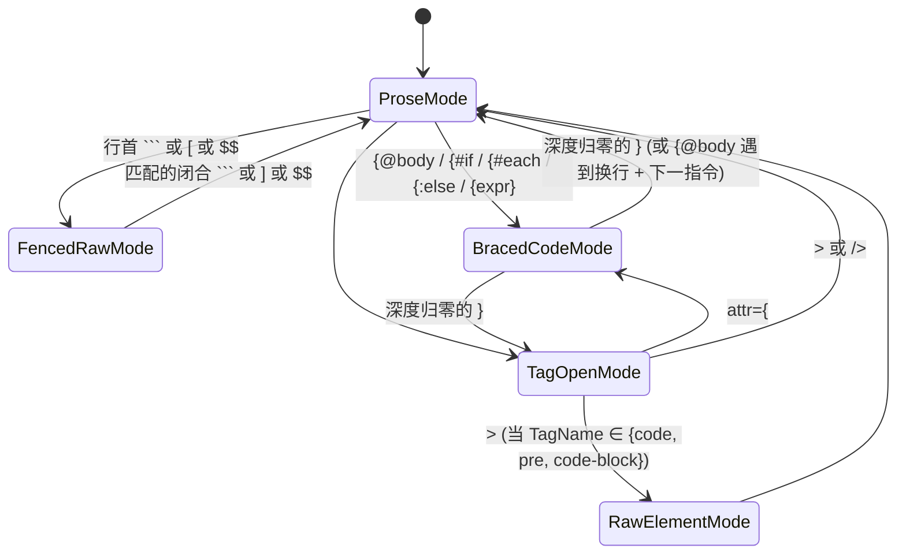
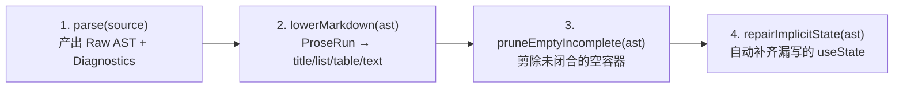

# DIL + Markdown 混排语法规范（EBNF）与容错恢复设计

研究日期：2026-11-18（Asia/Shanghai）  
适用目标：`pi-web-ui`（`src/web/src/core/dil/`）  
前置文档：[01-dil-empirical-research.md](./01-empirical-research.md)、[06-dil-compiler-and-runtime-architecture.md](./03-compiler-and-runtime.md)、[07-dil-streaming-behavior.md](./04-streaming-behavior.md)

---

## 1. 设计思想：借鉴 Tree-sitter 的三大核心机制（纯 TS 实现）

Tree-sitter 是现代增量容错解析器（用于 Zed、Neovim、GitHub 等）的工业标准。虽然我们不需要在浏览器里引入笨重的 `web-tree-sitter` WASM 运行时与 C 编译器工具链，但 ChatGPT 的 DIL 编译器与我们的 `src/core/dil/` 在设计上与 **Tree-sitter 的三大核心思想** 完全同构：

### 1.1 语法定义与 EBNF 同构
Tree-sitter 的 `grammar.js`（`seq`、`choice`、`repeat`、`optional`）本质上就是可执行的 EBNF。由于 DIL 只有 5 种核心语法构造（元素标签、条件块、循环块、`{@body}` 声明、表达式插值），用 EBNF 定义后可以直接 **1:1 映射为手写递归下降函数**，无需 GLR 状态表生成。

### 1.2 多语言范围注入（Language Injection / `included_ranges`）
Tree-sitter 解析 Svelte / Vue / MDX 时，**不会把 HTML、JavaScript、Markdown 揉进同一个巨型语法表**，而是采用 **宿主语法（Host Grammar）+ 注入范围（Injection Ranges）** 的分层架构：
1. **外层宿主解析器（DIL Structural Parser）**：识别围栏代码块/数学块边界、`{@body ...}`、`{#if ...}`、`{#each ...}` 和 `<tag attr={...}>`，将其余连续纯文本标记为 `ProseSpan`，将 `{...}` 内部标记为 `JsExprSpan`。
2. **Markdown 注入层（Markdown Lowering）**：仅对 `ProseSpan` 调用 GFM 词法切分（如 `marked.Lexer`），降级为 `title`、`text`、`list`、`table`、`code-block` 节点。
3. **JS 表达式注入层（Expression Evaluator）**：仅对 `JsExprSpan` 解析并安全求值。

### 1.3 区分 `MISSING`（虚拟补齐）与 `ERROR`（局部跳过）
Tree-sitter 之所以能在代码写到一半时依然给出可用的语法树，核心在于把语法残缺分为两类——这与我们在 [07-dil-streaming-behavior.md](./04-streaming-behavior.md) 中抓包观测到的 ChatGPT `recoveryDiagnostics` 逐一对应：

| Tree-sitter 容错概念 | ChatGPT DIL 诊断码 | 触发场景示例 | AST 恢复动作 | 渲染层表现 |
|---|---|---|---|---|
| **`MISSING` Token**<br/>（零宽虚拟节点插入） | `unclosed_block`<br/>`unterminated_braced_value` | `<box padding={3}>\n **标题**`（流式末尾尚未收到 `</box>`） | 在 EOF 或父节点闭合处**虚拟插入 `</box>`**，保留 `ElementNode`（标记 `closed: false`） | 若内部已有非空子节点则正常渲染容器；若内部为空则剪枝（防空框闪烁） |
| **`ERROR` Node**<br/>（局部错误包裹与跳过） | `unterminated_tag`<br/>`malformed_terminator` | `<box background="rgba(59,`（起始标签本身未写完 `>`） | 将半截 `<box ...` 包裹为诊断并**从渲染树中丢弃（Drop）** | 界面完全不渲染该半截标签，等待后续帧闭合 `>` |

---

## 2. 词法模态（Lexical Modes）与状态机

DIL 是典型的**上下文相关多模态语言（Context-Sensitive Modal Language）**，同一个字符（如 `<`、`>`、`{`、`}`）在不同模态下具有完全不同的词法含义。Scanner 根据 Parser 当前所处的语法位置在 **5 个词法模态** 之间切换：



| 模态名称 | 进入条件 | 内部词法规则 | 退出条件 |
|---|---|---|---|
| **1. `ProseMode`**<br/>（文档与子节点流） | 默认初始状态，或普通元素 `<box>` 的内部 | 识别行首围栏 ```` ``` ````、行内反引号 `` `...` ``、数学公式 `$...$`/`\[...\]`、DIL 块指令 `{@`/`{#`/`{:`/`{/`、插值 `{`、以及合法标签头 `<[A-Za-z_$]`。孤立的 `<`（如 `a < b`）视为普通文本 | 遇到匹配的 `</TagName>`、`{:else}`、`{/if}`、`{/each}` 或 `EOF` |
| **2. `TagOpenMode`**<br/>（起始标签头） | 在 `ProseMode` 下遇到 `<` 紧跟合法标识符 | 解析属性名、`="string"`、`='string'`、布尔标志，遇到 `={ ` 时推入 `BracedCodeMode`。**注意：箭头函数 `onChange={v => ...}` 内的 `>` 在 `BracedCodeMode` 中被消费，绝不会提前终结 `TagOpenMode`** | 遇到顶层 `>` 或自闭合 `/>`（或 `EOF` 触发 `unterminated_tag`） |
| **3. `BracedCodeMode`**<br/>（花括号 JS 扫描） | 遇到 `{@`、`{#`、`{:`、`{`（插值或属性值 `={ `） | 运行平衡括号扫描器 `readBalanced`：跟踪 `{}` 深度，跳过字符串 `"..."`/`'...'`、转义符 `\`、正则字面量 `/.../`、单多行注释，并递归处理模板字符串 `` `...${...}...` `` | `{}` 深度归零遇到 `}`；特例：`{@body` 若未闭合但下一行行首出现 `{@` 或 `<Tag` 则在行尾强制截断 |
| **4. `FencedRawMode`**<br/>（Markdown 裸块） | `ProseMode` 下遇到 ```` ``` ````、`~~~`、`$$` 或 `\[` | 内部所有 `<`、`>`、`{`、`}` 全部作为纯文本字节，不触发任何 DIL 解析 | 遇到匹配的结束围栏或 `EOF`（`EOF` 时标记 `incomplete_source` 并原样保留文本） |
| **5. `RawElementMode`**<br/>（代码标签裸文本） | `TagOpenMode` 闭合 `>` 且标签名 $\in$ `{"code", "pre", "code-block"}` | 内部所有 `{`、`}`、`<`（如 `<code>for i := 0; i < n; i++ { ... }</code>`）全部作为纯文本处理 | 遇到字面量 `</code...>` 或 `EOF` |

---

## 3. 形式化语法定义（EBNF）

独立语法文件见 [dil.ebnf](./dil.ebnf)。以下 EBNF 定义了统一 AST 的全部产生式，并在右侧标注了对应的 **流式容错恢复规则（Recovery Semantics）**：

```ebnf
(* ==================== 1. 顶层文档 vs 元素内部（双层边界） ==================== *)
Document        ::= DocumentNode* ;

DocumentNode    ::= AppDirective
                  | IfBlock
                  | EachBlock
                  | Element
                  | FencedBlock
                  | BlockProse ;          (* 顶层支持完整块级 Markdown，禁用 4 空格缩进代码块 *)

ElementChild    ::= IfElementBlock
                  | EachElementBlock
                  | Element
                  | FencedBlock
                  | InlineFlow ;          (* 元素内部仅支持 Inline Markdown 子集 + 空行分段 *)

(* ==================== 2. {@body} 状态与声明 ==================== *)
AppDirective    ::= "{@" DirectiveName Ws+ JsStatements "}" ;
                    (* [Recovery]:
                       1. 若未闭合 "}" 且尚未换行 (如 "{@body const x =") -> Action: Defer (丢弃，不在本帧求值)
                       2. 若未闭合 "}" 但下一行出现 ^\s*(\{@|<[A-Za-z]) -> Action: RecoverAtEOL (在行尾虚拟闭合 "}") *)

DirectiveName   ::= "body" ;

(* ==================== 3. 控制流块 ({#if} / {#each}) ==================== *)
IfBlock         ::= "{#if" Ws+ JsExpr "}" DocumentNode*
                    ( "{:else" Ws+ "if" Ws+ JsExpr "}" DocumentNode* )*
                    ( "{:else}" DocumentNode* )?
                    "{/if}" ;
IfElementBlock  ::= "{#if" Ws+ JsExpr "}" ElementChild*
                    ( "{:else" Ws+ "if" Ws+ JsExpr "}" ElementChild* )*
                    ( "{:else}" ElementChild* )?
                    "{/if}" ;
                    (* [Recovery]:
                       1. 头部 "{#if expr" 缺少 "}" -> Action: RecoverAtEOF (条件表达式若语法非法则回退为 false)
                       2. 缺少末尾 "{/if}" -> Action: InsertMissingClose (在 EOF 或外层父标签闭合处虚拟闭合) *)

EachBlock        ::= "{#each" Ws+ JsExpr Ws+ "as" Ws+ LoopPattern "}" DocumentNode* "{/each}" ;
EachElementBlock ::= "{#each" Ws+ JsExpr Ws+ "as" Ws+ LoopPattern "}" ElementChild* "{/each}" ;
                    (* [Recovery]:
                       1. 缺少 "as item" 或列表表达式非法 -> Action: FallbackExpr (list 回退为 "[]", item 回退为 "item")
                       2. 缺少末尾 "{/each}" -> Action: InsertMissingClose (在 EOF 或外层父标签闭合处虚拟闭合) *)

LoopPattern     ::= Identifier ( Ws* "," Ws* Identifier )? ;

(* ==================== 4. DIL 元素与属性 ==================== *)
Element         ::= "<" TagName ( Ws+ Attribute )* Ws*
                    ( "/>"
                    | ">" ElementContent "</" TagName Ws* ">" ) ;
                    (* [Recovery]:
                       1. 起始标签未遇到 ">" 或 "/>" 即到达 EOF (如 "<box padding={3")
                          -> Action: DropErrorNode (诊断: unterminated_tag，整节点丢弃不入树)
                       2. 已遇到 ">" 但到达 EOF 仍未遇到 "</TagName>"
                          -> Action: InsertMissingClose (诊断: unclosed_block，标记 node.closed = false)
                       3. 遇到 "</OtherTag>" 与当前 TagName 不匹配
                          -> Action: RecoverMismatchedTag (诊断: mismatched_tag，若外层栈存在 OtherTag 则闭合至外层，否则消费该闭合标签) *)

ElementContent  ::= RawTextContent          (* 当 TagName ∈ {"code", "pre", "code-block"} *)
                  | ElementChild* ;         (* 其余所有标签：内部只走 ElementChild *)

TagName         ::= [A-Za-z_$] [A-Za-z0-9_$]* ( [-.] [A-Za-z_$] [A-Za-z0-9_$]* )* ;

Attribute       ::= AttrName ( "=" AttrValue )? ;
                    (* 省略 "=..." 时为布尔属性 { [AttrName]: true } *)

AttrName        ::= [A-Za-z_$] [A-Za-z0-9_$:-]* ;

AttrValue       ::= '"' DoubleQuotedChars '"'
                  | "'" SingleQuotedChars "'"
                  | "{" JsExpr "}" ;
                    (* [Recovery]:
                       若 AttrValue 处于流式末尾未闭合 -> 触发外层 Element 的 unterminated_tag 整节点丢弃 *)

(* ==================== 5. 插值、围栏块与双层 Markdown ==================== *)
Interpolation   ::= "{" JsExpr "}" ;
                    (* [Recovery]:
                       若未闭合 "}" 或 JsExpr 语法不合法 -> Action: FallbackNull (求值回退为 null) *)

FencedBlock     ::= CodeFence | MathBlock ;
CodeFence       ::= "```" InfoString? "\n" RawChars ( "```" | EOF ) ;
MathBlock       ::= ( "$$" RawChars ( "$$" | EOF ) )
                  | ( "\\[" RawChars ( "\\]" | EOF ) ) ;

BlockProse      ::= ( HeadingBlock | HorizontalRule | ListBlock | TableBlock | BlockquoteBlock | ParagraphBlock )+ ;
InlineFlow      ::= InlineRun ( BlankLine+ InlineRun )* ;
InlineRun       ::= ( InlineCodeSpan | InlineMathSpan | BoldSpan | ItalicSpan | StrikeSpan | InlineLink | Interpolation | InlineDilElement | PlainTextChar )+ ;
```

---

## 4. AST 后处理管线（Post-Parse Passes）

从 EBNF 解析出初始 AST 后，经过 **3 个轻量无副作用的纯函数 Pass**，即可直接交给 React `<DilRenderer>` 渲染：



### Pass 1：`lowerMarkdown(ast)` — 双层 Markdown 语法糖降级（`BlockProse` vs `InlineFlow`）
根据 76 个真实样本的统计，DIL 在**顶层文档（`DocumentNode`）**与**元素内部（`ElementChild`）**使用的是完全不同层级的 Markdown 子集（详见 [dil.ebnf](./dil.ebnf) 第 1 节与第 7 节）：

1. **顶层文档级（`BlockProse`，仅限 `<box>` 等容器外部）**：
   * 支持完整块级语法：`HeadingBlock` (`#`~`######` $\rightarrow$ `<title>`)、`ListBlock` (`-`/`1.` $\rightarrow$ `<list>`)、`TableBlock` (GFM 表格 $\rightarrow$ `<table>`)、`BlockquoteBlock` (`>` $\rightarrow$ `<blockquote>`)、`HorizontalRule` (`---` $\rightarrow$ `<divider>`)、`ParagraphBlock` ($\rightarrow$ `<text>`)。
   * **显式禁用 CommonMark 的“4 空格缩进代码块”规则**：DIL 中的缩进纯粹用于 XML 层级排版，代码块永远是显式的 `CodeFence`（```` ```lang ````）或 `<code-block>`。
2. **DIL 元素内部级（`InlineFlow`，位于 `<box>` / `<row>` / `<radio>` / `<list-item>` 内部）**：
   * **不走块级 CommonMark 解析器**：元素内部的列表和表格一律使用原生 `<list>` 和 `<table>` 标签，文本只使用 **Inline Markdown 子集**（`BoldSpan` `**...**`、`ItalicSpan` `*...*`、`StrikeSpan` `~~...~~`、`InlineCodeSpan` `` `...` ``、`InlineMathSpan` `$...$` / `\(...\)`、`InlineLink` `[...](...)`）。
   * **忽略行首排版缩进**：`<box>` 内部的多行缩进直接作为普通空白处理，绝不触发缩进代码块。
   * **单段不包裹、多段按空行 `\n\n` 切分**：若元素内部只有单段 `InlineRun`，直接展开为行内节点（保持 `<row>数量：{n}</row>` 的 Flex 流）；若包含空行 `BlankLine`（`\n\n`），则按空行切分为多个 `<text>` 段落。
   * **统一 `InlineRun` 不断行**：`$math$`、`{expr}` 以及行内标签（`<icon>`、`<badge>`、`<Link>`、`<math>`、`<code>`、`<bold>`）与两侧文字同属一个 `InlineRun`，不会打断句子或丢失两侧空格。

### Pass 2：`pruneEmptyIncomplete(ast)` — 流式未闭合空容器剪枝
直接实现 [07-dil-streaming-behavior.md](./04-streaming-behavior.md#L126-L157) 中观测到的 Frame 45 防闪烁规则：
```typescript
const CONTAINER_TAGS = new Set([
  "box", "row", "col", "grid", "grid-item",
  "list", "list-item", "table", "table-row", "table-cell",
  "radio-group", "blockquote", "svg"
]);

function pruneEmptyIncomplete(nodes: DilNode[]): DilNode[] {
  const out: DilNode[] = [];
  for (const node of nodes) {
    if (node.type === "element") {
      const children = pruneEmptyIncomplete(node.children);
      // 若容器尚未闭合（missing closing tag）且内部还没有任何可渲染子节点，暂不挂载
      if (!node.closed && CONTAINER_TAGS.has(node.name) && children.length === 0) {
        continue;
      }
      out.push({ ...node, children });
    } else if (node.type === "if") {
      out.push({
        ...node,
        branches: node.branches.map((b) => ({ ...b, body: pruneEmptyIncomplete(b.body) })),
      });
    } else if (node.type === "each") {
      out.push({ ...node, body: pruneEmptyIncomplete(node.body) });
    } else {
      out.push(node);
    }
  }
  return out;
}
```

### Pass 3：`repairImplicitState(ast)` — 未声明受控状态自动修补
扫描树中所有同时带有 `value={x}`（或 `checked={x}`）和 `onChange={setX}` 的交互控件（`<radio-group>`、`<textarea>`、`<slider>` 等）：若顶层 `{@body}` 未声明 `x` 与 `setX`，则根据控件的第一个 `<radio value="...">` 或默认值自动在顶部补齐 `const [x, setX] = DIL.useState(seed)`，防止模型忘写 `{@body}` 导致控件失效。
